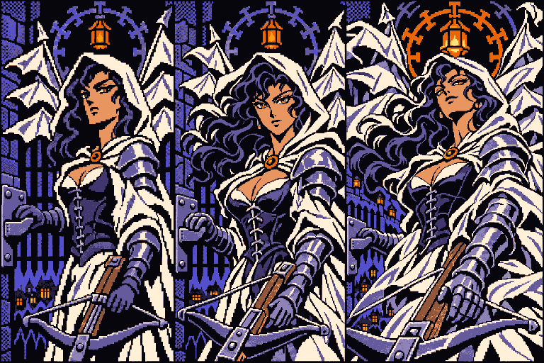

# EGA Dungeon Crawler with retro anime character art

Aaron chose the **middle Insomnia** as the drawing reference for all 200 Sisters. The **right Insomnia** is the staging reference for divine pulls. The approval covers rendering and staging. Each Order and Sister gets her own design review.

## Drawing a Sister

Start with the action her kit or vow demands. Insomnia looks straight at the player as her hand lowers the gate latch. Her composure does more to establish her character than the amount of armour she wears. Give the next Sister a different decision and a gesture that makes it visible.

Draw a clearly adult face with an individual jaw, brow angle and lid weight. Group hair into a few substantial curls, braids or planes. Use a small eye highlight where the expression needs one. Shape the garment around her role and build. Insomnia’s hood, curls, neckline, lantern and crossbow belong to her. A roster row should contain different women even when all their portraits are reduced to monochrome.

Build the picture in chunky square pixels. Group the silhouette into shadow, local colour and light. Preserve the Order colours and reserve a palette entry for the story’s decisive accent. Here that accent is the lantern flame. Use patterned dither selectively on stone, deep cloth or a large shadow. Keep the planes describing the mouth, eyes and fingers clean. The reference is a portable 768 × 512 proof using 16 colours.

Confessors of Glass have faceless heads and bodies of glass, stained glass or mirror at every rank. A head cut like a lancet, a broad lead seam or a reflection that shifts when she tilts her head can carry the expression. Use solid colour behind each highlight on the sprite.

## Giving each view a job

| View | Compose for its use |
| --- | --- |
| Bust | Bring the expression or glass head into immediate focus at 128 × 128. Check the hair or head silhouette and one personal detail again at 64 px. |
| Battle | Preserve the approved proportions and major shapes through the 128 × 192 intake. Fold divine ornament close to the body. Follow the template and run the preview in the [sprite spec](specs/SPRITE_SPEC.md). |
| Splash | Stage one decision at 256 × 384. Keep head, face and hands in the safe middle band. Frame her action with the architecture and light of her Order. |

## Divine pull staging

Every rank gets the middle study’s character appeal. R Commanders and SR Legends carry the scene through stance, hardware and mortal deeds. SSR Demigoddesses introduce wings and a partial halo. UR Deities may fill the splash with many wings and a full crown or halo while floating. Limited UR Patrons claim an Order-exclusive sign and the widest scale. Use the right panel for its upward camera, converging lines and enlarged silhouettes. Design the miracle around the individual Sister’s kit. See the [rank rules](specs/CONTENT_RULES.md).

## Keeping the likeness

Record the approved head shape, features or glass pattern, build, garment construction, personal mark and weapon silhouette below the Sister’s GAME DATA block. Attach her approved bust and prop sheet for her sprite, then attach her approved likeness and equipment when composing her splash. Use the reference above for rendering and each Sister’s own references for identity. Edit approved images for corrections.

When using an older card prompt, keep its GAME DATA and framing. Replace inherited renderer language and blanket dither instructions with this direction. The [game specs](specs/README.md) describe what each delivery must fit today.
