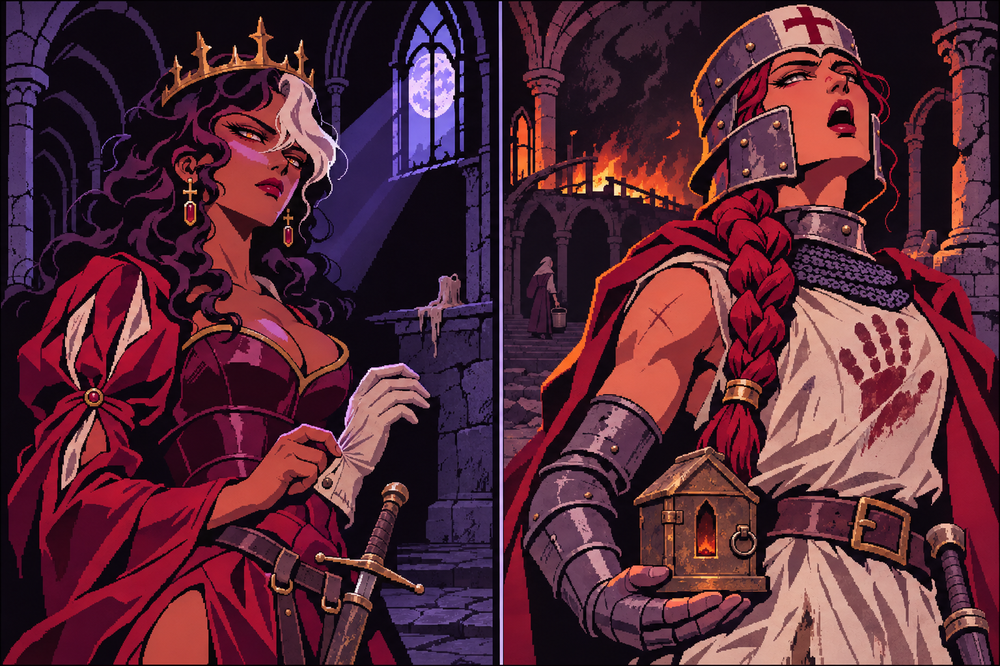

# Midnight Vigil

Midnight Vigil is the required rendering direction for new and revised CRT Crusaders illustrations in the seven-Order redesign. The master is the revised *Moonlit Duel, Firelit Reliquary* diptych.

## Making a picture

Attach the [master image](references/midnight-vigil.png) as a visual input on every generation and revision. For an approved scene or character, also attach its approved image and identify the two roles in the brief. The approved subject supplies the design and composition. The diptych supplies the drawing, shadow shapes, edges and finish. Earlier outputs can supply continuity, but each pass goes back to the master for rendering.

Draw the scene in broad inked silhouettes and hard-edged planes of local colour. Let nearby forms share a deep shadow. Use sparse, deliberate pixel accents where a contour turns or material catches light. Keep texture subordinate to the silhouette. In the moonlit panel, a few violet edges describe the arch while the glove seam catches the eye. In the firelit panel, bronze catches the light where the templar cups the reliquary. Choose an equally specific focal detail and a light source the viewer can locate. Keep the colours and time of day appropriate to the subject.

In an environment, the decisive gesture can belong to an object. At the Undertide Stair, the three keys have to read at hand height. Let distant masonry fall into shadow before either the keys or their candle disappears. For a style-only revision preserve the camera, crop, relative scale, architecture, props, atmosphere and story. Order territory studies are entirely unpopulated.

## Review before approval

Compare each candidate with the master at thumbnail size and at normal viewing size. At thumbnail size the focal action or object and the main shadow groups should read immediately. At normal size check for inked contours, clearly separated cel tones and highlights motivated by the scene. For a revision, compare against the approved subject image as well. Check distinctive objects, counts, placements and framing. Revise or flag any discrepancy before treating the picture as a replacement.

Include the master link, the subject reference when applicable, and one concrete comparison in the art review. Aaron approves a replacement before it becomes the reference for later work. The same review applies to every image in a batch.

## Earlier production guidance

The following notes document the [earlier Insomnia study](references/insomnia-ega-anime.png) and its character production context. The current seven-Order [creative decisions](CREATIVE_DECISIONS.md), [Order records](Orders/) and Midnight Vigil master above take precedence for the redesign.

## Drawing a Sister

Start with the action her kit or vow demands. Insomnia looks straight at the player as her hand lowers the gate latch. Her composure does more to establish her character than the amount of armour she wears. Give the next Sister a different decision and a gesture that makes it visible.

Draw a clearly adult face with an individual jaw, brow angle and lid weight. Group hair into a few substantial curls, braids or planes. Use a small eye highlight where the expression needs one. Shape the garment around her role and build. Insomnia’s hood, curls, neckline, lantern and crossbow belong to her. A roster row should contain different women even when all their portraits are reduced to monochrome.

Build the picture in chunky square pixels. Group the silhouette into shadow, local colour and light. Preserve the Order colours and reserve a palette entry for the story’s decisive accent. Here that accent is the lantern flame. Use patterned dither selectively on stone, deep cloth or a large shadow. Keep the planes describing the mouth, eyes and fingers clean. The reference is a portable 768 × 512 proof using 16 colours.

Confessors of Glass have faceless heads and bodies of glass, stained glass or mirror at every rank. A head cut like a lancet, a broad lead seam or a reflection that shifts when she tilts her head can carry the expression. Use solid colour behind each highlight on the sprite.

## Giving each view a job

| View | Compose for its use |
| --- | --- |
| Bust | Bring the expression or glass head into immediate focus at 128 × 128. Check the hair or head silhouette and one personal detail again at 64 px. |
| Battle | Preserve the approved proportions and major shapes through the 128 × 192 intake. Fold divine ornament close to the body. Follow the template and run the preview in the [sprite spec](specs/SPRITE_SPEC.md). |
| Splash | Paint the 1024 × 1536 master in full colour; the game shows a 512 × 768 copy. Keep head, face and hands in the safe middle band. Frame her action with the architecture and light of her Order. |

## Divine pull staging

Every rank gets the middle study’s character appeal. R Commanders and SR Legends carry the scene through stance, hardware and mortal deeds. SSR Demigoddesses introduce wings and a partial halo. UR Deities may fill the splash with many wings and a full crown or halo while floating. Limited UR Patrons claim an Order-exclusive sign and the widest scale. Use the right panel for its upward camera, converging lines and enlarged silhouettes. Design the miracle around the individual Sister’s kit. See the [rank rules](specs/CONTENT_RULES.md).

## Keeping the likeness

Record the approved head shape, features or glass pattern, build, garment construction, personal mark and weapon silhouette below the Sister’s GAME DATA block. Attach her approved bust and prop sheet for her sprite, then attach her approved likeness and equipment when composing her splash. Use the reference above for rendering and each Sister’s own references for identity. Edit approved images for corrections.

When using an older card prompt, keep its GAME DATA and framing. Replace inherited renderer language and blanket dither instructions with this direction. The [game specs](specs/README.md) describe what each delivery must fit today.
