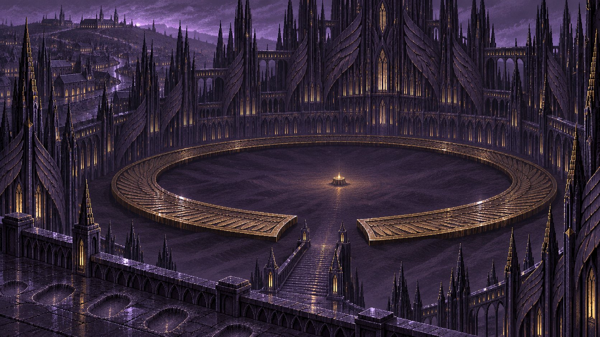
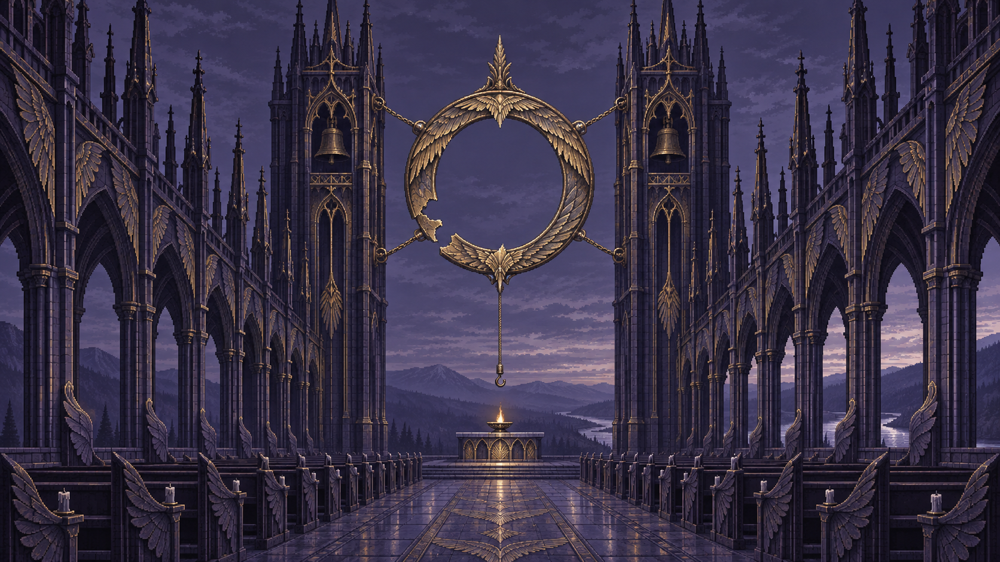

# The Host of Fearful Grace reference images

Both studies are approved homeland references.

## The Close of the Empty Halo

The vigil court. Its folded-wing silhouette encloses a single light in a broad expanse of dark sand.

## The Choir of the Unanswered Note

The open-air funeral choir. Two bells answer across the aisle while the halo hangs silent above the altar.
