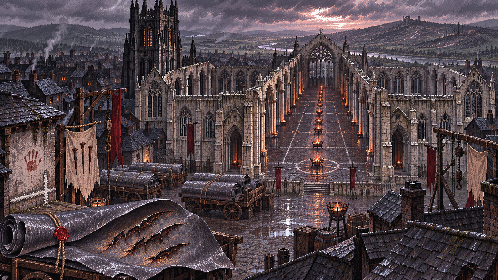

# The Red Office reference images

## The Cathedral of the Lifted Roof

Approved Midnight Vigil homeland study. The rolled lead in the square shows what prompted the purge. The exposed nave shows what it costs the parish to keep the cathedral consecrated.
