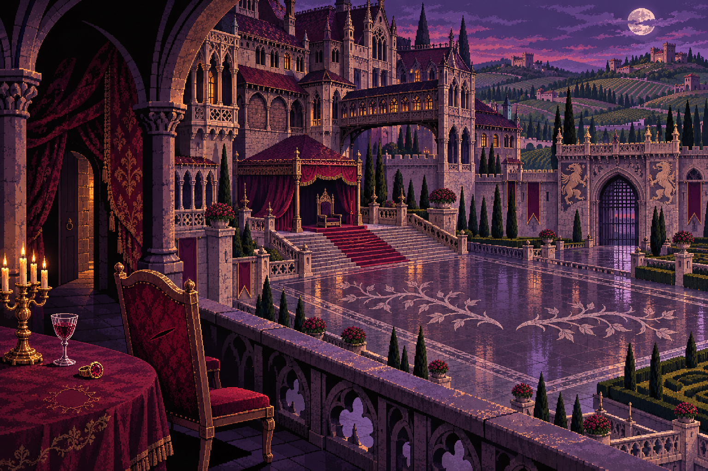

# The Scarlet Succession reference images

## Empty scarlet chair, dueling court

Approved territory reference. The marble dueling ground and ducal seat are visible from the houses above. A private passage opens behind the supper table, where a signet lies beside an untouched glass. The public court and the private room express how dueling and betrayal coexist among the nobility.
