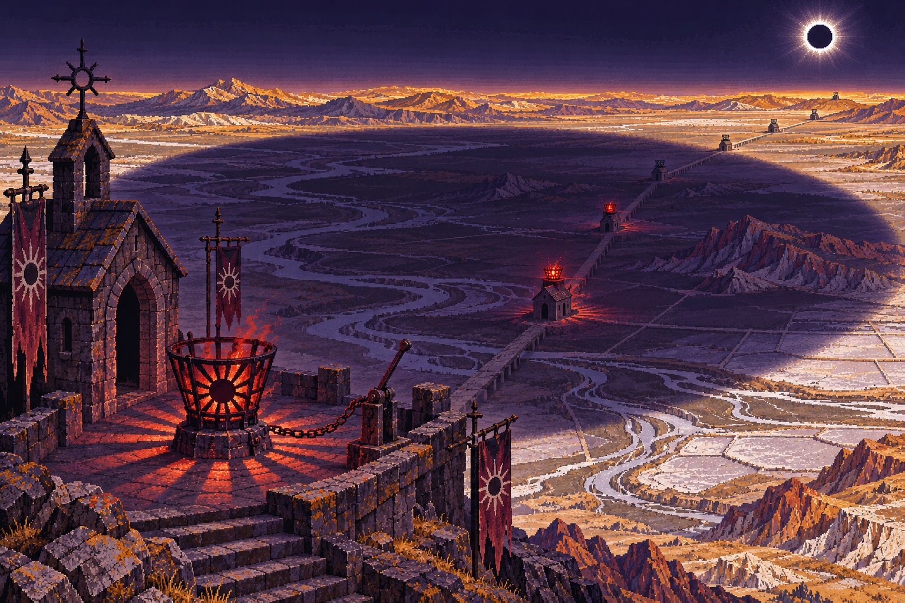

# Synod of the Veiled Sun reference images

## The Country Under the Shadow

Approved homeland reference. From the empty watch platform, the road can be followed through the umbra to the sunlit flats. A black disk at the center of the nearest brazier cuts spokes into the firelight on the stone. The more distant baskets stand dark.
