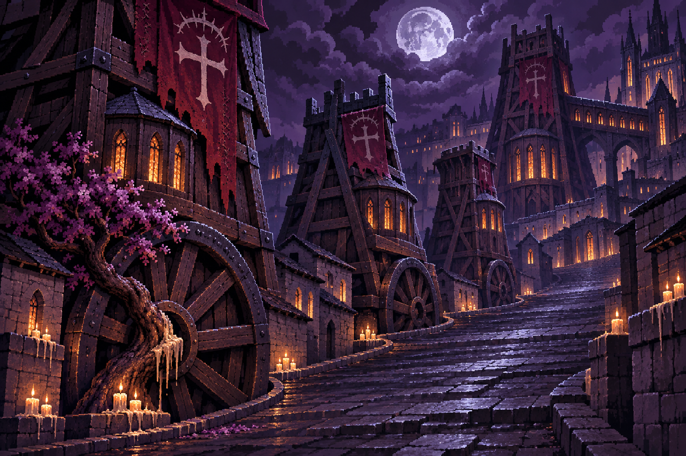

# The Sovereign Breach reference images

## The Procession at Rest

Approved homeland reference. From the foot of the street, the ironbound wheels and braced timbers still give the towers their siege silhouettes. Candlelight fills their chapel windows. Wax runs down the first hub beside the flowering plum.
