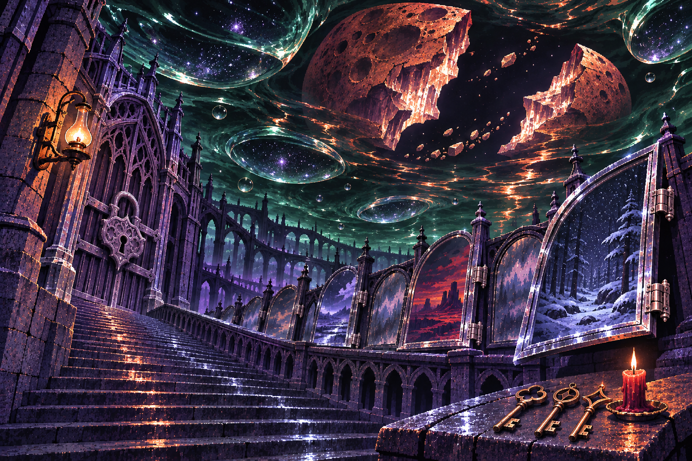

# The Vesperglass Testament reference images

## The Undertide Stair

Approved homeland reference, depicted from the foot of the stair. In the Vitrali sky, stars show through deep green swells and suspended drops. Loose stone hangs between the moon’s two exposed copper faces. The nearest open mirror looks onto a snowbound forest. A candle lights the three keys at hand height.
