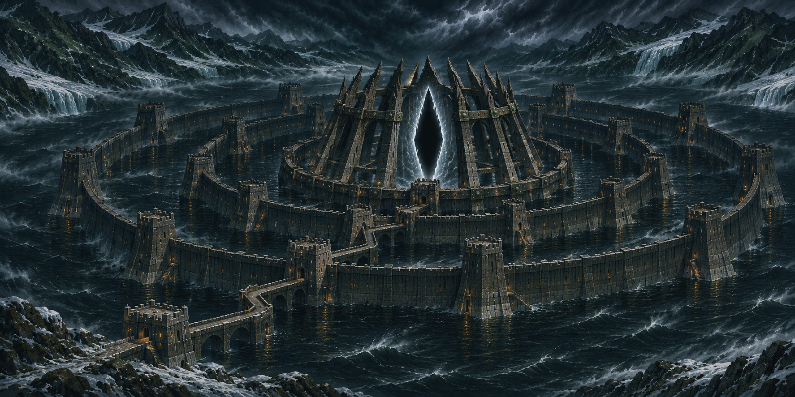

# The Wardens of the Inward Gate reference images

## The Drowned Crown

Approved Midnight Vigil territory study. The flooded rings and crown of ribs belong to this particular gate prison. Other Warden strongholds can take different forms and reach far greater sizes.
