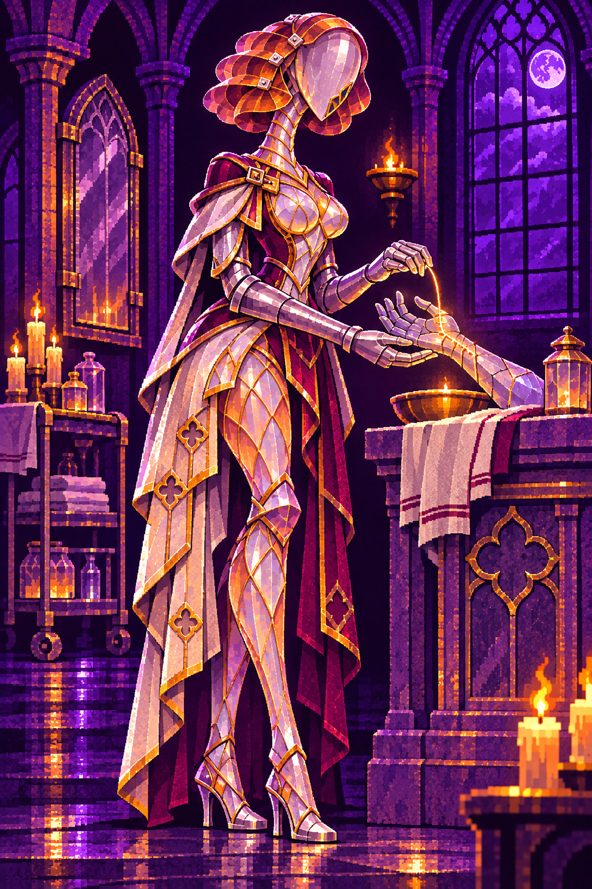
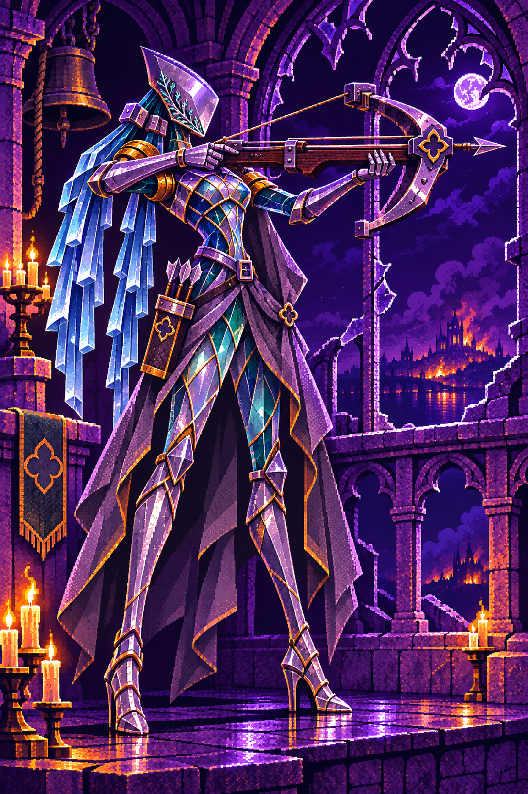

# Vitrali

**Approved race · Construct · Planeswalker**

The Vitrali live on a plane of their own. They cross the boundary between their homeland and other planes through mirrors. A Vitrali can prepare a mirror for someone else to cross. Their homeland serves as a travel hub for people of many planes.

## Sister affiliation

Every Sister of [The Vesperglass Testament](../../Orders/vesperglass-testament/) is Vitrali. A Vitrali Sister can belong only to the Testament. The race also includes civilians. The Order guards the barriers, keeps the routes between planes and serves as a peacekeeper across them.

## Locked visual formula

- **Body.** Build the figure from stained glass, mirror or mirrorlike surfaces, polished gold and silver. Let light pass through a colored pane, resolve a reflection in the mirror, and catch a thin edge along a metal fitting. Vary the glass color, opacity, panel shapes, seams and distribution across the body. The exposed surfaces are the Construct’s body.
- **Face.** Give each Vitrali a featureless face with an individual outline. A personal inlay, symbol or worked texture gives the face its likeness. Leave enough open surface to read the mirror. A turn of the head can bring the surrounding world into view. The off-center rose window is one individual’s mark.
- **Hair.** Build a recognizable hairstyle from shaped material. A glass ribbon can sweep into a curl, broad sections can interlock into a braid, and graduated prisms can fall from a clasp. Show the thickness at an edge, the air between pieces and the fitting that holds them. Biological hair and skin are absent.
- **Proportions.** Establish the individual body, face shape, inlay and hairstyle before fitting armor or assigning role equipment. Every Sister stands over 6′0″ and at most 7′2″. Within that range, vary the shoulders, waist, hips, neck, limbs and bearing. Civilian height is open.
- **Rendering.** Use Midnight Vigil. Group highlights into readable square pixel shapes. A window reflected in silver and candlelight transmitted through colored glass should look different even at portrait scale.

## Visual anchors

These role studies establish how widely individual Vitrali can differ. Individual roster assignments remain open.

| [Healer study](reference-images/healer.png) | [Ranged study](reference-images/ranged.png) |
| --- | --- |
|  |  |
| A long neck, pearl teardrop face and scalloped apricot bob. Her hands meet around the fracture as she draws a thread of gold through the wrist. | An angular face with a frost-fern inlay, long limbs and two falls of rigid blue prisms. The bevels stay legible as she sights along her arbalest. |
